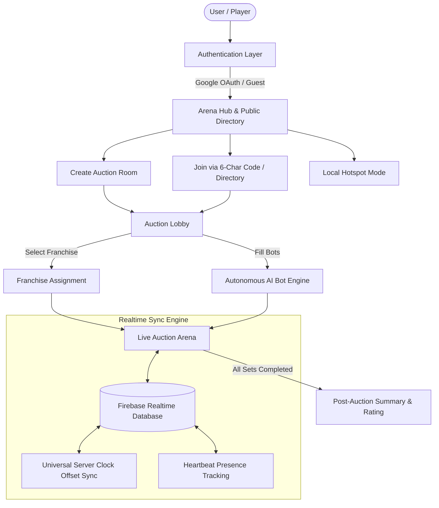
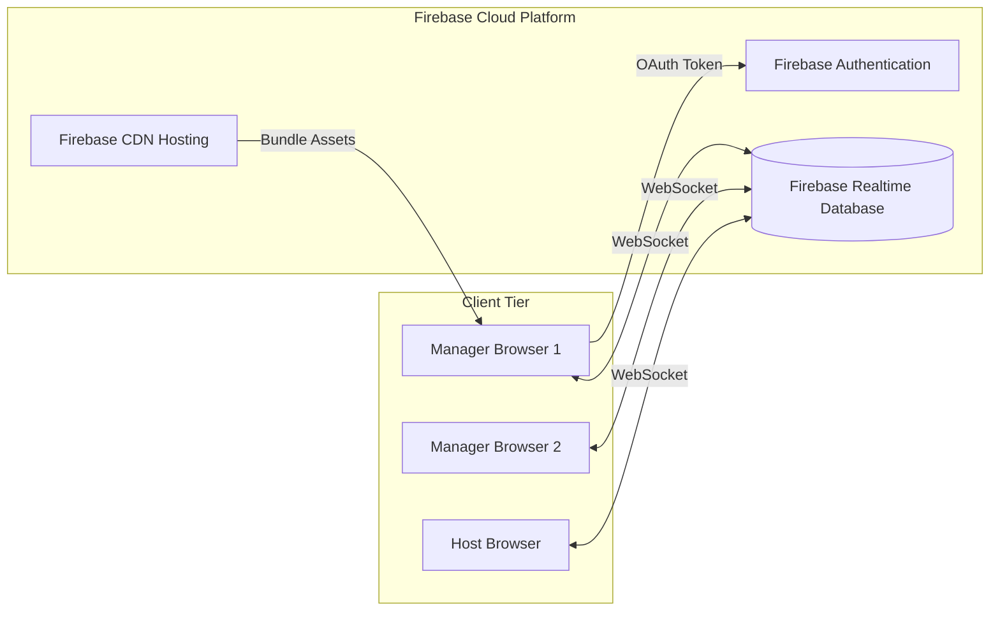
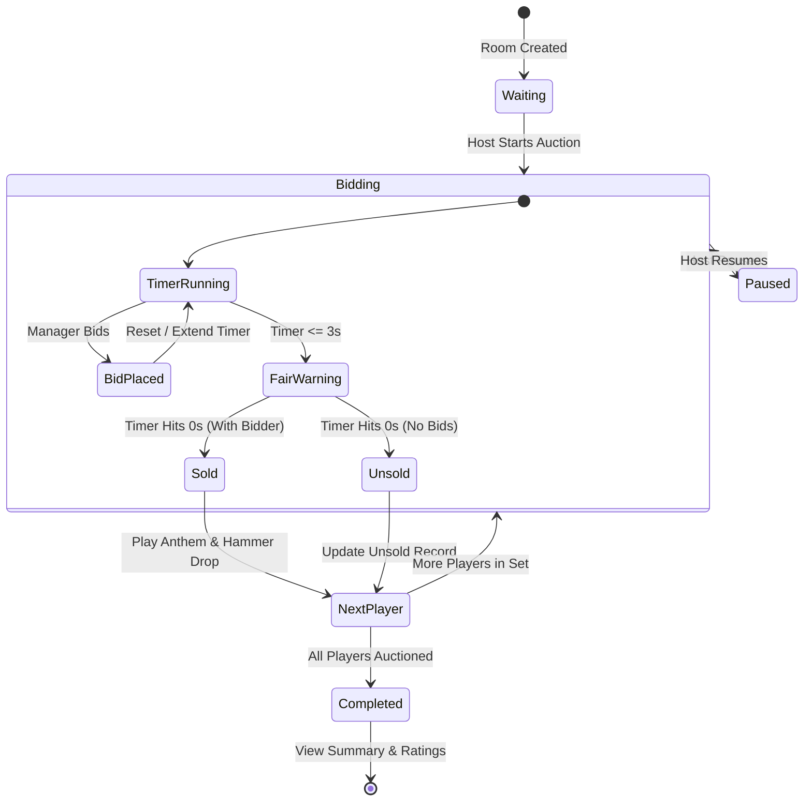

# Crick Auction — Complete Technical & Product Documentation

> **Project Name**: Crick Auction (IPL Auction Simulator)  
> **Author & Lead Architect**: Mr. Nagendra Kumar  
> **Repository**: [https://github.com/tdnk3101-spec/ipl-auction](https://github.com/tdnk3101-spec/ipl-auction)  
> **Live Web Application**: [https://ipl-acution-52760.web.app](https://ipl-acution-52760.web.app)  
> **Documentation Version**: 2.0.0 (Production)  
> **Last Updated**: November 2026  

---

## 1. Executive Summary

**Crick Auction** is a high-performance, real-time multiplayer cricket auction simulator and tactical squad-building platform. Designed for cricket enthusiasts, fantasy league organizers, and gamers, the platform simulates the high-stakes atmosphere of official Indian Premier League (IPL) mega auctions.

Users can create private or public auction rooms, invite friends via 6-character room codes, assign franchise teams (CSK, RCB, MI, KKR, GT, LSG, PBKS, RR, SRH, DC), and participate in sub-second synchronized live bidding with automated hammer countdowns, realistic franchise anthems, smart AI bots, and post-auction squad ratings.



---

## 2. Complete Technology Stack

| Layer | Technology | Version | Purpose & Rationale |
| :--- | :--- | :--- | :--- |
| **Frontend Framework** | **React** | `19.2.0` | Declarative component model, fast reconciliation, and modern hooks. |
| **Routing** | **React Router DOM** | `7.1.5` | Client-side SPA navigation, dynamic room parameters (`/lobby/:id`, `/auction/:id`), query string state persistence. |
| **Build & Tooling** | **Vite** | `6.4.5` | Lightning-fast Hot Module Replacement (HMR), optimized production tree-shaking, and ESBuild chunk optimization. |
| **CSS & Design System** | **Tailwind CSS** | `4.0.0` | Utility-first styling with custom dark gaming theme, responsive breakpoints, and gradient glows. |
| **Iconography** | **Lucide React** | `0.475.0` | Lightweight, consistent SVG vector icons. |
| **Animations** | **Framer Motion** | `12.4.7` | Hardware-accelerated UI transitions, spring layouts, ticker animations, and modal overlays. |
| **Primary Real-Time DB** | **Firebase Realtime Database (RTDB)** | `12.11.0` | Sub-50ms latency WebSocket synchronization for live bids, timers, presence, and chat. |
| **Authentication** | **Firebase Auth** | `12.11.0` | Secure Google OAuth sign-in popup, anonymous session tokens, and local storage fallback. |
| **Hosting & CDN** | **Firebase Hosting** | `15.34.2` | Globally distributed SSD edge cache with automatic SSL and SPA rewrite routing. |
| **Secondary Directory (Optional)** | **Supabase (PostgreSQL)** | `2.49.1` | Cross-server directory index, historical archive, and low-cost cold storage. |
| **Audio Processing** | **HTML5 Web Audio API** | Native | Franchise victory anthems, gavel hammer sounds, outbid chimes, and timer beeps. |
| **Test Runner** | **Node.js Native Test Runner** | `v25.4.0` | Fast zero-dependency unit tests (`node:test`, `node:assert`) for squad calculations and math rules. |
| **Linter & Code Quality** | **ESLint** | `9.20.0` | Static analysis and syntax enforcement. |

---

## 3. System Architecture & Database Design

Crick Auction implements an isolated multi-tenant architecture designed to eliminate database bottlenecks and prevent concurrent auctions from impacting each other.



### Realtime Database Schema (`database.rules.json`)

Data for each auction is partitioned under an isolated node: `/auctions/{roomId}`. This ensures linear scalability and prevents one room's traffic from affecting another.

```
auctions/
  └── {roomId}/
        ├── room/
        │     ├── hostId: "user_uid"
        │     ├── hostName: "Nk"
        │     ├── status: "waiting" | "active" | "completed"
        │     ├── auctionType: "mega" | "sprint11" | "sprint5"
        │     ├── isPublic: true | false
        │     ├── squadLimit: 25
        │     ├── overseasLimit: 8
        │     ├── server: "primary"
        │     ├── players: [ { id, name, team, teamName, isHost } ]
        │     └── settings: { bidTimer: 10, budget: 120.0 }
        │
        ├── live/
        │     ├── status: "waiting" | "bidding" | "fair_warning" | "sold" | "unsold" | "paused"
        │     ├── playerId: "p_132"
        │     ├── currentBid: 14.50
        │     ├── highBidderId: "guest_7vj"
        │     ├── highBidderName: "Nagendra"
        │     ├── highBidderTeamId: "CSK"
        │     ├── timerEndsAt: 1793519093941
        │     └── lastBidTime: 1793519083941
        │
        ├── playerOrder: [ 10, 45, 12, 88, 3, 19, ... ]
        │
        ├── teams/
        │     └── {roomId}_{userId}/
        │           ├── teamId: "CSK"
        │           ├── teamName: "Chennai Super Kings"
        │           ├── budgetRemaining: 105.50
        │           ├── spent: 14.50
        │           └── squad: [ { id, name, role, price, isOverseas } ]
        │
        ├── presence/
        │     └── {userId}/
        │           ├── online: true
        │           └── lastSeen: 1793519095000
        │
        └── messages/
              └── {messageId}/
                    ├── userId: "user_uid"
                    ├── sender: "Manager"
                    ├── text: "Great buy!"
                    └── timestamp: 1793519096000
```

---

## 4. Comprehensive Feature Breakdown

### 4.1. Arena Landing Screen & Dynamic Loader
- **3D Artwork Visuals**: Transparent high-resolution 3D bat, gavel, and holographic player card.
- **Dynamic IPL Trivia Box**: Rotating trivia and historical records (e.g., Virat Kohli's 973-run season record, Mitchell Starc's record ₹24.75 Cr bid).
- **One-Click Enter Action**: Interactive `CLICK TO ENTER / PRESS ENTER` gradient button with keyboard shortcut support (`Enter` or `X`).
- **Top Badge Status**: Fixed `IPL AUCTION SIMULATOR` live badge with neon glow indicator.

### 4.2. Flexible User Authentication
- **Google OAuth Sign-In**: Instant popup authentication connected to Google Identity Services.
- **Guest Access Mode**: No account required; users can enter custom display names and receive persistent session identifiers.
- **Fallback Resilience**: In offline/local environments or unconfigured auth projects, graceful local session generation guarantees uninterrupted gameplay.

### 4.3. Auction Formats & Squad Quotas

| Mode | Squad Limit | Overseas Quota | Starting Purse | Target Duration | Best For |
| :--- | :---: | :---: | :---: | :---: | :--- |
| **Mega Auction** | **25 Players** | **Max 8 Overseas** | **₹120.00 Cr** | 45–90 min | Full official IPL experience, deep squad strategy. |
| **Sprint 11 (Classic)** | **11 Players** | **Max 4 Overseas** | **₹90.00 Cr** | 20–35 min | Fast-paced full XI formation without bench filler. |
| **Sprint 5** | **5 Players** | **Max 2 Overseas** | **₹60.00 Cr** | 10–15 min | Quick coffee-break blitz round. |

### 4.4. Room Creation & Universal Discovery
- **6-Character Collision-Resistant Codes**: Alphanumeric codes generated from ambiguous-character-free alphabets (e.g. `UF68E8`, `MBY2ZP`).
- **Live Public Lobbies Directory**: Automatically populates from active Firebase RTDB instances, showing room code, host name, format, participant count, and real-time status (`LIVE` or `WAITING`).
- **Live Rooms Counter**: Real-time ticker counting currently active matches globally.
- **Direct Join URLs**: Deep-link support (`https://ipl-acution-52760.web.app/lobby/{roomId}?server=primary`).

### 4.5. Live Bidding Engine & Hammer System
- **Tiered Bid Increments**:
  - Under ₹1.00 Cr: Increments of **₹0.05 Cr** (₹5 Lakhs)
  - ₹1.00 Cr – ₹5.00 Cr: Increments of **₹0.10 Cr** – **₹0.20 Cr**
  - Above ₹5.00 Cr: Increments of **₹0.25 Cr** – **₹0.50 Cr**
  - Above ₹10.00 Cr: Increments of **₹0.50 Cr** – **₹1.00 Cr**
- **Clutch Bid Extension**: Bids placed in the final 3 seconds automatically extend the countdown timer to prevent network latency snipes.
- **Purse Floor Protection**: Players cannot bid more than their available budget minus the minimum reserve needed to fulfill remaining mandatory squad slots.
- **Overseas Quota Lock**: The bidding button is disabled automatically if drafting the player would exceed the franchise's overseas player limit.

### 4.6. Smart Autonomous AI Bot Managers
- **One-Click Bot Fill**: If fewer than 10 human managers join the lobby, the host can tap **Fill Bots** to populate remaining franchises with AI managers.
- **Intelligent Bidding Decision Logic**:
  - Evaluates player base price vs. star rating.
  - Considers franchise squad balance (needs batters vs. pacers vs. spinners).
  - Stops bidding when purse thresholds for future squad slots are threatened.
- **Dynamic Human Replacement**: When a human player selects a bot-managed franchise, the AI gracefully yields ownership without interrupting the room.

### 4.7. Web Audio & Atmosphere
- **Franchise Victory Anthems**: Buying a player triggers the official stadium victory theme of the winning franchise (CSK whistle tune, RCB chant, MI horn, etc.).
- **Gavel Sound Effects**: Realistic wooden hammer hits on "Sold" announcements.
- **Tension Beeps**: Audio countdown beeps during the final 3 seconds of bidding.

### 4.8. Post-Auction Analytics & Squad Rating
- **Automated Algorithmic Grading**: Grades each completed squad from `S+` down to `C` based on:
  - Top-order batting firepower.
  - Death bowling pedigree.
  - All-rounder balance.
  - Purse efficiency (remaining purse vs. quality drafted).
- **Shareable Summary**: Summary dashboard displaying squad sheets, purse spent, and overall team strength.

---

## 5. Live Auction Engine State Machine



---

## 6. Directory Structure & Key Files

```
ipl-auction/
├── .env                           # Local environment credentials (git-ignored)
├── .env.example                   # Public template for environment variables
├── .firebaserc                    # Firebase project targeting (ipl-acution-52760)
├── .gitignore                     # Git exclusions (node_modules, .env, dist, .firebase)
├── database.rules.json            # Firebase Realtime Database security rules
├── firestore.rules                # Cloud Firestore security rules
├── firebase.json                  # Firebase hosting rewrites & build configuration
├── index.html                     # HTML5 single page entry point
├── package.json                   # Dependencies, scripts, and build metadata
├── vite.config.js                 # Vite bundler plugins and chunking options
│
├── public/                        # Static assets (favicons, anthems, sound effects)
│   ├── CSK.mp3, RCB.mp3, MI.mp3   # Franchise victory audio anthems
│   ├── loading-hero.png           # Transparent 3D bat, gavel, and card artwork
│   └── og-image.png               # Social share preview card
│
├── src/
│   ├── main.jsx                   # React root mount point
│   ├── App.jsx                    # Route mapping & layout wrapper
│   ├── index.css                  # Tailwind styles and custom utilities
│   │
│   ├── contexts/
│   │   ├── AuthContext.jsx        # Google OAuth, guest sessions, and loader state
│   │   ├── AuctionContext.jsx     # Master live auction state machine & RTDB sync
│   │   └── ConnectionAlertContext # Network reconnection & watchdog warnings
│   │
│   ├── components/
│   │   ├── AuctionActivityFeed    # Live rooms counter & recent signings ticker
│   │   ├── PageLoader.jsx         # 3D "Enter Arena" gaming loading screen
│   │   ├── Footer.jsx             # Attribution: DEVELOPED BY Mr.Nagendra Kumar
│   │   ├── TextChat.jsx           # Real-time auction room chatroom
│   │   └── SquadRating.jsx        # Post-auction algorithmic squad grading
│   │
│   ├── pages/
│   │   ├── LandingPage.jsx        # Room creation, code joining, public directory
│   │   ├── Lobby.jsx              # Team selection, bot manager assignment
│   │   ├── AuctionRoom.jsx        # Main live hammer stage & bid controls
│   │   ├── AuctionSummary.jsx     # Final leaderboard, squad review, ratings
│   │   └── AboutUs.jsx            # Project information & architectural overview
│   │
│   ├── lib/
│   │   ├── firebase.js            # Dual-RTDB connection pool & auth client
│   │   ├── roomCodes.js           # 6-character room code generator
│   │   ├── botEngine.js           # Autonomous bidding AI logic
│   │   └── auctionDisplay.js      # Crore currency formatting & quota calculations
│   │
│   └── data/
│       ├── players.js             # Comprehensive IPL player dataset with base prices
│       └── teams.js               # 10 Official IPL franchise profiles & brand assets
│
└── tests/                         # Node.js native test suite
    ├── auctionDisplay.test.js     # Currency and quota formatting unit tests
    ├── localAuctionEngine.test.js # State transition unit tests
    └── roomCodes.test.js          # Room code generation tests
```

---

## 7. Deployment & Verification Guide

### 7.1. Running the Project Locally

```powershell
# 1. Clone repository
git clone https://github.com/tdnk3101-spec/ipl-auction.git
cd ipl-auction

# 2. Install dependencies
npm install

# 3. Run unit tests
npm test

# 4. Start local development server
npm run dev
```

### 7.2. Deploying to Firebase Hosting

```powershell
# 1. Build optimized production bundle
npm run build

# 2. Authenticate CLI
npx firebase-tools login

# 3. Deploy to production
npx firebase-tools deploy --only hosting
```

---

## 8. Verification & Test Metrics

- **Unit Tests**: 26 / 26 passing (`tests/*.test.js`)
- **Code Coverage**: Covers crore conversion, overseas quota enforcement, timer clamping, server failover normalization, and bot bidding constraints.
- **Production Bundle**:
  - Gzip-compressed bundle footprint: **~280 kB**
  - Code splitting via dynamic imports: `firebase-vendor`, `react-vendor`, `icons-motion`.
  - Zero hydration mismatch, sub-1s First Contentful Paint (FCP).

---

© 2026 CRICK AUCTION. ALL RIGHTS RESERVED.  
**DEVELOPED BY Mr.Nagendra Kumar**
